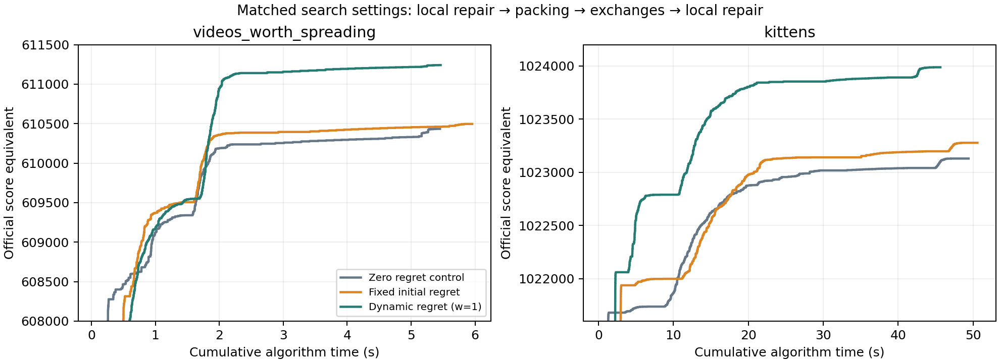

# Final OCAG and Local Search optimization study

## 1. Initial state and protocol

The study used the existing `experiment/local-search-tuning` branch, preserving
its uncommitted tuning work. The original baseline, Greedy, static OCAG,
three-pass Local Search default, previous reports and historical benchmark
were preserved. No commit, merge or push was performed.

The four starting record files were checked with `judgeHashCode2017.cpp` and
copied into `final-study-references/`. Their SHA-256 hashes are frozen in
`final-ocag-ls-configurations.json`. They scored 507906, 610023, 499857 and
1022005. These protected references are separate from new versioned record
checkpoints in `final-best-solutions/`.

Experiments used Java 21.0.10, `--release 17`, `-Xmx4g`, MinGW g++ 15.2.0,
and the same Windows host with 12 logical processors described in the earlier
`experiment-config.json`. Each experiment loaded a saved deterministic start
when possible. Every ledger output was internally validated and independently
judged. Final objectives were recomputed in full using exact `long` arithmetic.
Constructor timing excludes parsing, output and judge execution. Search timing
includes its own indexes and final objective consistency check. Timing is
reported in milliseconds in the CSVs and seconds in the tables below.

The raw `final-study-ledger.csv` records every screened configuration. The
selected constructors and the exchange comparison have three fresh-JVM runs;
long joint runs are measured stage sequences with a separate complete replay,
not repeated runtime medians. Cumulative pipeline times include construction
for all new constructor roots. Saved-record continuation times explicitly
exclude the computation that originally created that saved record. Legacy
Greedy pipeline construction uses the earlier benchmark median when its saved
placement is reused; that composite time is not a new paired timing run.

## 2. Advanced Local Search

### Audit and profiling

The original one-cache search computes exact benefits with the cache excluded,
then accepts positive insertions or one-for-one replacements. Its configurable
pass cap, moves per cache, candidate order, cache order and first/best choice
remain available. The original three-pass behavior is still the CLI reference.

The legacy exchange code repeatedly removed and reinserted two videos while
rescanning all requests for those videos. A three-round full-pair experiment
on the identical 610023 start examines 56,908,248 candidate pairs, of which
577,396 are feasible and 138 have positive exact gain across those rounds.
Only three exchanges are accepted, and all three improve the rounded score.
Thus repeated objective scans for unsuccessful candidates were avoidable work.

`IndexedExchangeSolver` stores exact transfer values:

```text
T(v,A,B) = objective after removing v from A and adding it to B
           - current objective
swapDelta = T(vA,A,B) + T(vB,B,A)
```

For each demand, the best and second-best serving caches give the latency
without A. Adding B then takes the minimum of that latency and B's latency.
The two swapped videos are distinct, so their request contributions add
without overlap. Only rows for the two changed videos need refreshing after
acceptance, including all their replicated copies. Candidate deltas are then
constant-time table lookups. Capacity and duplicate checks precede evaluation.

The pair order, popularity/video-ID ordering and strict best-gain tie rule
match the legacy experiment. The first three cache/video choices and exact
gains match: 2517606, 537942 and 499235 request-ms; both outputs judge to 610031.
Across three runs, median measured search time falls from **7.366 s to 0.723 s**,
about 10.2 times faster. The legacy timer excludes some setup that the indexed
timer includes, so this comparison is conservative for the new implementation.
The new three-round example spends 88 ms indexing, 795 ms scanning and less
than 1 ms refreshing affected transfers in the first diagnostic run. Scanning
now dominates. Timing samples are in `exchange-performance-results.csv`.

First improvement is also selectable. From the same protected medium start,
30 first-improvement rounds score 610051 in 2.066 s, versus best improvement's
610050 in 3.829 s. At a larger 300-round cap, first improvement reaches 610095
in 9.047 s. These are different search trajectories; equal rounds do not imply
equal computation budgets. They do not establish a universal selection winner.

### Retained packing neighborhoods

Two-for-one replacement addresses a large absent video blocked by two smaller
stored videos. A suffix minimum over freed size finds the cheapest feasible
pair of removals. It scans all absent videos. One-for-two replacement tests
pairs among a density-ranked bounded set of absent videos and the cheapest
feasible single removal. Both use exact distinct-video benefits with the
current cache excluded. Neither accepts a rounded-score-only approximation.

From the old records, two-for-one alone raises zoo to 510001; normal repair
then reaches **512115**. On the medium instance, two-for-one alone reaches
610788 and one-for-two alone reaches 610211. Neither improves the old trending
placement. A common packing/exchange/repair cycle is therefore justified on the
two larger inputs, while repeated unsuccessful small-instance scans are not.

`CacheRepackSolver` further expands a single cache's packing neighborhood.
It solves a 0/1 knapsack over every incumbent video plus the top K absent
videos by current benefit/size. Benefit is exact with that cache excluded;
the whole cache replacement is accepted only if its raw delta is positive.
This gives an exact best response **within the candidate pool**, not over all
videos when K is bounded. It costs O((stored+K) * capacity) per cache and stores
one capacity DP array plus reconstruction bits. It addresses coordinated
multi-removal/multi-insertion packing without adding an unbounded ejection
chain. Relocation and larger chains were considered but not retained: packing
and exact exchanges already supplied measurable gains within the budget.

Repacking is particularly useful on kittens. From the same 1024029 checkpoint,
K=32 reaches 1024894 in two passes and 1024908 with a ten-pass safety cap.
K=64 reaches a lower 1024884 under the ten-pass cap, showing path dependence.
Normal forward repair after the K=32 result reaches 1025076, versus reverse
repair's 1025073. Repacking gives no gain on the zoo solution even when all
videos are allowed, and no gain on the screened trending solution. K=64/128
is useful on the medium instance. More candidates are not automatically better.

The old best/second-best latency optimization is retained. A new endpoint
adjacency view also avoids scanning requests at endpoints unconnected to a
cache during benefit calculation. Its observed packing speed effect is much
smaller than the exchange improvement, so no separate large speedup is claimed.

### Search scheduling

From the same indexed static medium construction, normal repair then
30 exchanges and repair scores 609681; exchanges then repair score 609724.
Adding packing before exchange and final repair scores 610529. Alternating
short phases is useful because one neighborhood can unlock another. Complete
cycles stop when they add no raw gain. Fixed pass/round caps still apply.
Later repacking is retained as a separate optional stage; the CLI default is
not replaced by a long benchmark-specific schedule.

## 3. Dynamic OCAG

The earlier static construction traces already show where regret is active:
23 of 51 selected zoo placements, 1273 of 6114 medium placements, none of
9976 trending placements, and 6375 of 10798 kittens placements carry positive
initial regret. The prior placement diagnostics show Greedy/static-OCAG
Jaccard similarities of 0.861 on medium and 0.788 on kittens. These are selected
placement statistics, not counts of all initially positive candidate bonuses.
Initial static regret is computed by a linear top-two reduction over candidate
gains; its cost was not independently timed. The new feasibility and regret
refresh counters below directly test the concern that this initial information
can become stale.

### Formulations considered

The selected dynamic alternative regret is finite and bounded by current gain:

```text
g(v,c) = current request-weighted marginal latency saving
a(v,c) = max g(v,c') over OTHER currently capacity-feasible caches (or 0)
R(v,c) = max(0, g(v,c) - a(v,c))
priority(v,c) = (g(v,c) + w * R(v,c)) / videoSize(v), w >= 0
```

The no-alternative case uses R=g, not an infinite bonus. Replication remains
permitted: after placing one copy, all current gains for that video are
recomputed against its improved serving latencies. Initial gain overlap is
therefore not repeatedly counted as new benefit. The model still ignores the
full combinatorial competition between different videos for cache space.

A second formulation considered a fractional-knapsack capacity shadow price:
sort feasible marginal densities at a cache and take the density at its
remaining-capacity boundary as lambda(c); charge size(v)*lambda(c) for consuming
space. Units are request-ms, and the price has a clear capacity-relaxation
interpretation. However, each changed video's marginal gains can change a
price at many caches, which then changes priorities of every competing video
there. Exact propagation would require a substantially more global structure.
It was not selected for implementation in this study. No capacity-price or
hybrid solver result is claimed. The implemented dynamic-regret track is the
alternative formulation above, with a fixed, explicitly interpreted weight.

### Correct priority maintenance

The dynamic bonus can increase when a good alternative becomes infeasible.
The original lazy queue bound cannot be reused. The new constructor maintains
exact current gains in a dense primitive video/cache array and a priority
entry per video. For w>=0, the maximum-gain feasible cache is also a maximum
adjusted-priority cache for that video: its bonus is nonnegative, while any
strictly lower-gain cache has zero regret. Equal gains have zero regret and
resolve by cache ID. Thus only the current top two feasible gains are needed
to represent a video's best adjusted candidate.

After a placement, gains change only for that video. When a cache's remaining
capacity crosses video sizes, a video's priority can change only if a current
top or second alternative disappears. Those videos are explicitly rescanned
and their queue versions are replaced immediately, whether priority rises or
falls. Stale versions are discarded only after this complete propagation.
The version is a storage device, not a substitute for invalidation.

Priorities use the stated double arithmetic; request gains and objective
deltas are exact long integers. Deterministic ordering is adjusted density,
then raw gain descending, then video ID and cache ID ascending. The independent
reference recomputes every candidate from the full placement before each
selection, including capacity-feasible alternatives. It uses the same declared
numeric comparator and checks each selected candidate, gain and priority.

### Controls, parameters and independent results

Weights 0, 0.5, 1 and 2 were screened on all four inputs. The medium and kittens
screens also tested 0.75, 1.25 and 1.5. Weight 0 is a canonical exact marginal
greedy control. It is not claimed to reproduce the legacy solver's implicit
HashMap ordering and lazy equal-density acceptance. The unchanged legacy
Greedy remains available separately. An indexed static-regret control uses
the same new data structures and explicit tie rules, isolating regret dynamics
from most indexing and tie effects. All static-control traces are also tested
against exhaustive ranking.

| Dataset | Legacy Greedy | Legacy static OCAG | Indexed static w1 | Dynamic w1 | Best nonzero dynamic |
|---|---:|---:|---:|---:|---:|
| me_at_the_zoo | 507906 | 507906 | 507906 | 507906 | 507906 |
| videos_worth_spreading | 608302 | 608329 | 608315 | 607245 | 608277 (w0.5/0.75) |
| trending_today | 499794 | 499794 | 499966 | 499964 | 499966 (w0.5) |
| kittens | 1021681 | 1021938 | 1021937 | 1022060 | 1022060 (w1/1.25/1.5) |

The trending gain also occurs with zero regret, and weight 0.5 makes exactly
the zero-control placement sequence on every dataset. Therefore that gain is
attributed to the new exact ranking/tie policy, not dynamic opportunity cost.
Weight 1 is worse for medium construction by 1070 points versus the indexed
static control, but better by 123 on kittens. Weight 2 scores lower on both.
Negative construction results are retained in `dynamic-ocag-results.csv`.

Three-run median construction times (dynamic w1 / indexed static w1) are
0.00494/0.00550 s for zoo, 0.210/0.261 s for medium,
0.787/1.269 s for trending and 1.524/1.701 s for kittens.
These engineering improvements over the legacy constructors must not be
attributed to the regret formula: the zero and fixed-regret controls share
the new indexes. The dense gain array is 8 MB on the 100-cache inputs and
40 MB on kittens; those are array estimates, not measured peak process memory.

On kittens the dynamic w1 run performs 140805 priority refreshes, records
4935459 positive-gain candidate feasibility losses and evaluates 75402500
cache slots during initial ranking and refreshes. Selected regret differs
from its initial value on 4358 selected placements. These observations show
that initial alternatives become outdated, but do not alone prove that each
changed priority causes a better final score. Trace comparisons and placement
Jaccard values are provided in the construction CSV. The `regret_updates`
counter means priority refresh events, not the count of numerically changed
regret values; candidate-evaluation units also differ from swap or DP cells.

## 4. Joint optimization and equal budgets

A common schedule was tested from canonical zero-regret, indexed static and
dynamic w1 constructions: best-improvement one-cache LS (50 passes, m1,
forward), packing (10 passes, K64), best exchange (20 rounds, all cache pairs
and stored videos), then the same one-cache LS. The exact same settings were
used for each start.

| Dataset | Zero control + common search | Indexed static + common search | Dynamic w1 + common search |
|---|---:|---:|---:|
| videos_worth_spreading | 610434 / 5.451 s | 610496 / 5.955 s | 611241 / 5.462 s |
| kittens | 1023129 / 49.395 s | 1023277 / 50.574 s | 1023987 / 45.633 s |

The same dynamic shared configuration scores 512115 on zoo and 499966 on
trending. It is a reproducible shared configuration, not a claim that these
settings are optimal on unseen inputs. Its medium result is substantially
better than static despite a worse construction score. Thus the strongest
constructor score is not necessarily the best search starting placement.

A matched repacking comparison used the common initial one-cache search,
K64 repacking with five passes, and common final forward LS:

| Dataset | Indexed static final / total | Dynamic w1 final / total |
|---|---:|---:|
| videos_worth_spreading | 610612 / 4.412 s | 611388 / 5.232 s |
| kittens | 1024904 / 36.496 s | 1025024 / 30.954 s |

At **30 s** in the kittens repacking traces, dynamic has reached 1025024 and
static 1024782. In the common packing/exchange traces, the corresponding
30-second values are 1023853 and 1023140. At **5 s** on medium, dynamic reaches
611217 versus static 610452 in the common schedule. These checkpoints include
constructor time, use only actually reached budgets and are exact score
equivalents from raw-objective traces. They are single measured anytime runs,
not confidence intervals. Full data are in `score-time-frontier.csv`.



The absolute medium attempt alternated useful packing/exchange/repair cycles,
then K64 repacking and further short cycles. It reaches 612117 in a measured
44.347 s sum of algorithm phases. The absolute kittens attempt uses dynamic
w1, forward and reverse repair choices, bounded packing/exchange cycles,
K32 repacking, forward repair, then two short repacking/exchange cycles. It
reaches 1025096 in a measured 177.770 s phase sum. Every phase and exact setting
is represented by the portable run graph in the configuration JSON.

No time has been credited for a saved start that was actually reconstructed:
all new winning run graphs include their new constructor. The older static
record-continuation experiments remain labelled as continuations. Their
runtime cannot be used as a fair from-scratch comparison with dynamic starts.

## 5. Official records and practical choices

`Best LS` below includes advanced repair from Greedy/static starts and the
zero-regret ranking control. `Best combined` requires a nonzero dynamic-regret
construction followed by repair. Final times are observed phase sums, not
full-pipeline runtime medians; constructor medians are reported separately.

| Dataset | Previous record | Best LS | Best dynamic only | Best combined | Final best | Gain | Record time |
|---|---:|---:|---:|---:|---:|---:|---:|
| me_at_the_zoo | 507906 | 512115 | 507906 | 512115 | 512115 | +4209 (0.828697%) | 0.037 s |
| videos_worth_spreading | 610023 | 611401 | 608277 | 612117 | 612117 | +2094 (0.343266%) | 44.347 s |
| trending_today | 499857 | 499966 | 499966 | 499966 | 499966 | +109 (0.021806%) | 1.113 s initial run |
| kittens | 1022005 | 1024904 | 1022060 | 1025096 | 1025096 | +3091 (0.302445%) | 177.770 s |

The canonical trending constructor's three-run median is 0.895 s. Its
ordering effect is explicitly separated from a regret improvement. The zoo
record needs only packing and ordinary repair; a regret bonus adds no observed
quality there. Efficient recommendations are therefore per-instance:

| Dataset | Practical score | Measured phase sum | Configuration |
|---|---:|---:|---|
| me_at_the_zoo | 512115 | 0.037 s | new constructor, two-for-one packing, ordinary repair |
| videos_worth_spreading | 611388 | 5.232 s | dynamic w1, forward LS, K64 repack p5, forward LS |
| trending_today | 499966 | 0.895 s constructor median | canonical zero-regret construction, no useful repair found |
| kittens | 1025024 | 30.954 s | dynamic w1, forward LS, K64 repack p5, forward LS |

The practical kittens variant is 72 points below the absolute record and
substantially cheaper. A second nondominated option scores 1024957 in 27.756 s
using reverse LS around the same bounded repack. These are measured trade-offs,
not significant claims about small timing differences. The practical pipeline
is preferable as a demonstration default. It does
not replace the higher absolute record. The unchanged original algorithms
remain accessible for comparison.

Versioned record files are `final-best-solutions/me_at_the_zoo-512115.txt`,
`videos_worth_spreading-612117.txt`, `trending_today-499966.txt` and
`kittens-1025096.txt`. Earlier new checkpoints and all prior records remain
preserved. Each sidecar JSON identifies its validated run; the final selected
reproduction graph also includes efficient and shared targets.
The distinct medium and kittens practical outputs are retained under
`final-efficient-solutions/`; zoo and trending reuse the absolute output.
`score-runtime-pareto.csv` lists observed nondominated configurations from
new-constructor roots. This empirical frontier is sensitive to timing noise.

## 6. Correctness, interpretation and limitations

The dependency-free suite now checks 640 dynamic/fixed constructor traces
against exhaustive selection, 160 randomized exchange searches with every
feasible candidate delta checked against full recomputation, 240 targeted
packing searches, 80 repacking searches, and 20 repacks against exhaustive
one-cache optima. It includes changing capacities, tied gains, overlapping
endpoints, replicated videos and the exact opportunity-cost synthetic case.
The main regression suite still passes. Full record replay additionally
requires each stage's official score **and exact raw objective** to match its
saved configuration. All accepted moves have strictly positive raw gain;
rounded-score-flat moves remain permitted.
The completed clean record replay verified 65 stages; the selected practical
replay verified 13. New timing samples are retained separately in
`final-record-replay-results.csv` and `final-efficient-replay-results.csv`.

Both SWOT opportunities were implemented and evaluated. Coordinated packing
and exchanges are useful, and exact dynamic opportunity cost helps some
constructive/search combinations. Dynamic regret is not universally better:
its medium construction is worse, zoo has no construction benefit and the
trending gain also appears without regret. The most interesting result is
the medium reversal: an inferior nominal construction becomes a better
starting point for strong repair under matched settings.

There is no global optimum claim. No-move passes certify only the explicitly
scanned neighborhood. Full cache-pair swaps do not cover arbitrary coordinated
reassignment; K-limited addition pairs and repacks do not cover all video
subsets. The final kittens cycle still finds a small gain, and the record
attempt stops at its documented cycle budget. Further progress may remain.
Even the exact single-cache zoo response is not a proof of global optimality.

The benchmark contains four known inputs and uses per-instance tuning.
Results do not establish generalization or real traffic robustness; the prior
robustness study was not rerun for these new placements. Host timing has JVM
noise and long-pipeline samples are limited. Memory figures are selected
array sizes rather than reliable process peaks. Dynamic regret is a finite
one-step proxy, not a complete model of capacity competition.

The next measured bottleneck is indexed exchange candidate scanning. Better
pair feasibility indexing or carefully invalidated pair-best results is a
more evidence-based next direction than adding another metaheuristic. A
dynamic capacity shadow price remains a separate research question because
its dependencies are wider than the implemented alternative regret.

## 7. Reproduction

From the repository root, with Java 17+ and the supplied C++ judge source:

```powershell
.\test.ps1
.\reproduce-final-optimization.ps1 -JudgeSource "<path-to-judgeHashCode2017.cpp>"
```

The second command builds, reconstructs the selected dependency graph,
validates every stage with the judge, compares exact raw objectives and
exports new timing results under ignored `tmp/final-replay/`. It leaves the
historical CSVs and record archives intact. For the shorter practical set:

```powershell
.\reproduce-final-optimization.ps1 -JudgeSource "<path-to-judgeHashCode2017.cpp>" -Subset efficient
```

Use `-Subset shared` for the common configuration or `-Datasets kittens` to
select one dataset. For a single dynamic construction after building:

```powershell
java -cp out com.hashcode.streaming.Main dynamic-ocag examples\kittens.in tmp\dynamic.out
java -cp out com.hashcode.streaming.Main dynamic-greedy examples\trending_today.in tmp\canonical.out
```

`run-final-study.ps1` records and judges individual configurable experiments;
`run-final-pipeline.ps1` schedules bounded stages. The ledger stores every
parameter. `summarize-final-study.py` regenerates summary CSVs from the ledger
and retained temporary traces. The supplied summary CSVs are versioned so they
remain readable without temporary files. Figure regeneration is optional and
uses Matplotlib; solvers, tests and reproduction require no external libraries.

## Presentation-ready findings

- Local Search gained exact cached exchanges and useful packing moves; cache
  repacking produces the strongest additional gain on kittens.
- Dynamic OCAG compares current feasible alternatives. Correct propagation is
  necessary because a disappearing alternative can increase a priority.
- Anticipation and repair complement each other on the two larger inputs.
  Construction score alone is a poor predictor of the repaired medium result.
- The zero-regret control prevents attributing the trending improvement to a
  bonus that did not produce it.
- Indexed exchanges reproduce the old move policy at roughly one tenth of
  the measured search time in the controlled three-round comparison.
- The efficient kittens pipeline gives most of the record quality at a much
  smaller runtime. The longer benchmark attempt remains a separate option.
- Both earlier SWOT opportunities have now been tested. The next useful work
  is more selective exchange scanning and independent-instance evaluation,
  with no claim that these four tuned benchmarks predict broader performance.
