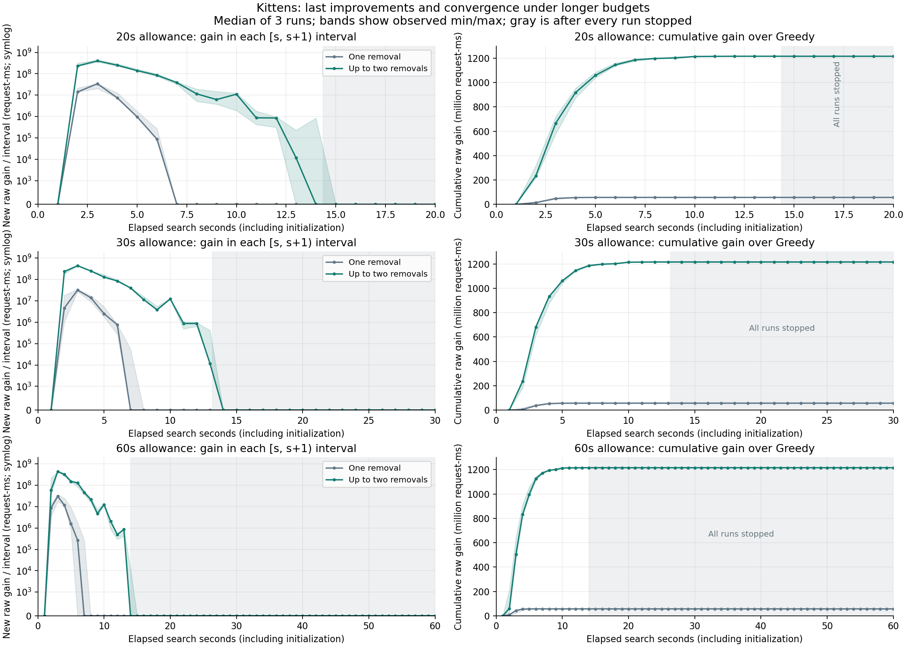

# Kittens: 20-, 30- and 60-second Local Search allowances

Experiment date: 2026-10-18. All 18 completed runs concern Kittens only: two neighborhoods, three budgets, three repetitions. The solver core is byte-for-byte unchanged from the earlier short-budget study. Only experiment recording and a separate post-search audit were extended.

## Result

Both neighborhoods converge before the smallest 20-second allowance in every repetition. Increasing the allowance to 30 or 60 seconds adds no score, raw gain or accepted moves. Every final placement is identical across all nine runs of its variant, verified by solution hashes.

| Allowance (s) | Neighborhood | Score | Accepted moves | Raw gain over Greedy (request-ms) | Verified local optima |
| --- | --- | ---: | ---: | ---: | ---: |
| 20 | one | 1,021,738 | 431 | 56,960,806 | 3/3 |
| 20 | two | 1,022,896 | 1,721 | 1,215,795,519 | 3/3 |
| 30 | one | 1,021,738 | 431 | 56,960,806 | 3/3 |
| 30 | two | 1,022,896 | 1,721 | 1,215,795,519 | 3/3 |
| 60 | one | 1,021,738 | 431 | 56,960,806 | 3/3 |
| 60 | two | 1,022,896 | 1,721 | 1,215,795,519 | 3/3 |

One permits additions and at most one removal. Two permits additions and at most two removals within one cache. A two-video removal counts as one accepted move. One converges in 8 passes with 20 additions and 411 single replacements. Two converges in 15 passes with 242 additions, 658 single replacements and 821 double replacements. The confirming no-change pass is included in the pass count.

## Last raw improvement and actual elapsed time

Times below are seconds from search start, including index initialization, reported as median [minimum, maximum] of three runs. Last improvement means the completion timestamp of the last accepted strictly positive raw request-ms gain, even if the integer score does not change.

| Allowance (s) | Neighborhood | Actual repair time | Last positive raw improvement | Separate audit time |
| --- | --- | ---: | ---: | ---: |
| 20 | one | 6.335 [6.204, 6.515] | 5.383 [5.311, 5.620] | 4.341 [3.347, 4.454] |
| 20 | two | 12.954 [12.555, 14.366] | 12.218 [11.836, 13.631] | 3.489 [3.480, 4.464] |
| 30 | one | 6.906 [6.548, 7.037] | 5.994 [5.638, 6.143] | 4.283 [3.261, 4.476] |
| 30 | two | 12.943 [12.898, 13.169] | 12.218 [12.161, 12.435] | 3.709 [3.545, 4.431] |
| 60 | one | 6.490 [5.505, 7.652] | 5.569 [4.830, 6.661] | 4.803 [3.416, 5.868] |
| 60 | two | 13.414 [12.977, 14.007] | 12.680 [12.252, 13.221] | 4.607 [4.435, 4.892] |

All runs terminate with no_improving_move, not time_budget or a pass limit. The independent complete audit finds maximum remaining positive gain = 0 and zero improving caches in all 18 cases. Thus these are verified local optima in their respective neighborhoods. This does not establish a global optimum, or rule out improvements requiring three removals or coordinated moves between caches.

## Per-second raw gain

Raw gain is the sum of accepted deltas in each half-open elapsed interval [s, s+1). Its unit is request-ms: request count multiplied by saved latency in milliseconds. It is not the rounded official score. Events exactly on an integer second belong to the following interval. Each run has exact integer gain totals; summaries have medians and observed ranges.

After a run stops, rows up to its nominal allowance are padded with zero gain and active_ms = 0. These are explicitly post-stop intervals, not evidence of continuing search. The final partial active interval records its actual duration. The CSV contains every second for all budgets and repetitions: 660 run/second rows, with 220 summary rows.



Lines show medians and bands observed minimum/maximum values. The left axis uses a symmetric-log scale with a linear region near zero, so small positive tail gains and zero remain visible. Points are plotted at interval ends. Gray regions begin only after every run in that budget group has stopped. Do not sum per-second medians to infer a run total; use the exact per-run rows or cumulative columns.

### Detailed 60-second profile

This table shows the active part of the 60-second group. All remaining intervals are retained individually in the CSV files. Active counts refer to runs with nonzero search time during the interval, regardless of whether a move was accepted.

| Interval (s) | One: median new raw gain | Two: median new raw gain | Two: minimum / maximum | Active runs: one / two |
| --- | ---: | ---: | ---: | ---: |
| [0, 1) | 0 | 0 | 0 / 0 | 3 / 3 |
| [1, 2) | 8,801,425 | 60,362,255 | 33,924,896 / 215,974,517 | 3 / 3 |
| [2, 3) | 30,269,850 | 439,890,280 | 428,843,331 / 445,410,892 | 3 / 3 |
| [3, 4) | 11,782,695 | 325,752,959 | 269,225,718 / 348,452,438 | 3 / 3 |
| [4, 5) | 1,613,519 | 150,056,621 | 144,879,093 / 174,524,523 | 3 / 3 |
| [5, 6) | 269,152 | 129,703,339 | 85,773,333 / 130,823,297 | 3 / 3 |
| [6, 7) | 0 | 45,987,313 | 37,401,624 / 55,238,521 | 2 / 3 |
| [7, 8) | 0 | 21,527,258 | 15,606,133 / 25,444,471 | 1 / 3 |
| [8, 9) | 0 | 4,740,705 | 3,831,115 / 7,276,956 | 0 / 3 |
| [9, 10) | 0 | 12,418,275 | 11,328,855 / 14,492,893 | 0 / 3 |
| [10, 11) | 0 | 2,033,449 | 869,373 / 2,079,444 | 0 / 3 |
| [11, 12) | 0 | 494,513 | 291,875 / 554,987 | 0 / 3 |
| [12, 13) | 0 | 854,337 | 418,020 / 887,189 | 0 / 3 |
| [13, 14) | 0 | 0 | 0 / 11,759 | 0 / 2 |
| [14, 15) | 0 | 0 | 0 / 0 | 0 / 1 |
| [15, 60), each second | 0 | 0 | 0 / 0 | 0 / 0 |

By 10 seconds, the 60-second group has accumulated 99.74% of the final two-removal raw improvement in the median cumulative profile. The remaining positive tail is small but real.

For example, in the first 20-second two-removal run, the integer score last increases at 11.046806 seconds (move 1,713). Eight further positive raw moves add 898,948 request-ms without changing that integer score. The last raw gain occurs at 12.218323 seconds (move 1,721); the final confirming pass ends at 12.953941 seconds. This is why score plateau and genuine local convergence must be distinguished.

## Independent convergence check

The audit is read-only and runs after the timed repair. It reconstructs request service alternatives from the actual final placement in fresh arrays, without reading the solver's internal latency states. Two scans per demand avoid quadratic cost in endpoint degree on Kittens. Removal losses use an independent size-sorted suffix oracle: the two cheapest distinct videos in each suffix allow each candidate first removal to query the cheapest feasible second removal. Every absent requested video and every cache is covered.

A run is verified locally optimal only if no feasible move has strictly positive raw gain. Any nonzero witness would be recorded in best_remaining_gain and the audit video/cache columns; a contradiction with no_improving_move raises an error. In this study all audited maxima are exactly zero. Audit time is separate from repair time and never uses the search allowance.

The oracle was checked against exhaustive enumeration on 40 fixed-seed random tiny placements in both neighborhoods, as well as crafted examples. Every accepted move and claimed convergence in those tests is checked exactly.

## Method and validation

- Hardware: AMD Ryzen 5 3600X, Windows 11, Oracle Java 17.0.12; 4 GB maximum heap, CPU only.
- Same newly constructed, serialized Greedy placement for both variants and all budgets: initial score 1,021,681. Inputs, source files and seed hashes are recorded.
- Fresh sequential JVMs; order alternates between variants across budgets/repetitions. Three samples per group provide observed ranges, not confidence intervals.
- Timed search has no pass cap. The allowance includes initialization, neighborhood evaluation and accepted updates, excluding parsing, seed reading/construction, scoring/validation, serialization and the independent audit. All runs stop before the deadline; none relies on permitted deadline overrun.
- Every timed output is independently scored and capacity-validated. All 18 traces were replayed to check removals, capacity, positive raw gains, final placements, last-improvement times and the exact 660-bin accounting.
- Every variant has identical final output hashes across all budgets and repetitions. Raw gains and move counts are identical too; timing differences reflect run variability.
- Existing solver regressions and all seven Python tests pass, including exact audit oracles and per-second boundary/partial-interval/post-stop tests.
- Scores use the repository implementation of the official formula. The external official judge was not run. Peak memory was not measured.

The initial audit attempt was interrupted before a completed measured worker was recorded because its direct exclusion scan had quadratic work in endpoint degree. The official results here are from the fresh v2 restart using the revised audit; no row from the interrupted attempt is mixed in. The LocalSearchSolver source hash is unchanged from the earlier short-budget experiment.

## Reproduce and inspect

```powershell
python .\benchmark-neighborhoods.py --datasets kittens --budgets-ms 20000 30000 60000 --repetitions 3 --audit --output-dir .\experiments\my-kittens-long-study
```

Set JAVA_HOME to a Java 17+ JDK. The output directory must be new. The script compiles a frozen snapshot of current sources.

- [All 18 runs, last-improvement times, audit flags and witness fields](runs.csv)
- [Summary with timing ranges and convergence counts](summary.csv)
- [Every second of every repetition](per-second-runs.csv)
- [Per-second medians, ranges and active counts](per-second-summary.csv)
- [60-second per-second profile](kittens-60s-per-second.csv)
- [Raw versus integer last-improvement times, and final solution hashes](convergence-details.csv)
- [Configuration, source/seed hashes and validation](configuration.json)
- [Full figure as SVG](per-second-gains.svg)

All 18 accepted-move traces are retained here. Full validated outputs, logs, per-run metrics, source snapshots and classes are in the ignored raw directory recorded in configuration.json. No existing experiment results were overwritten. No commit, push, service restart or deployment was performed.
